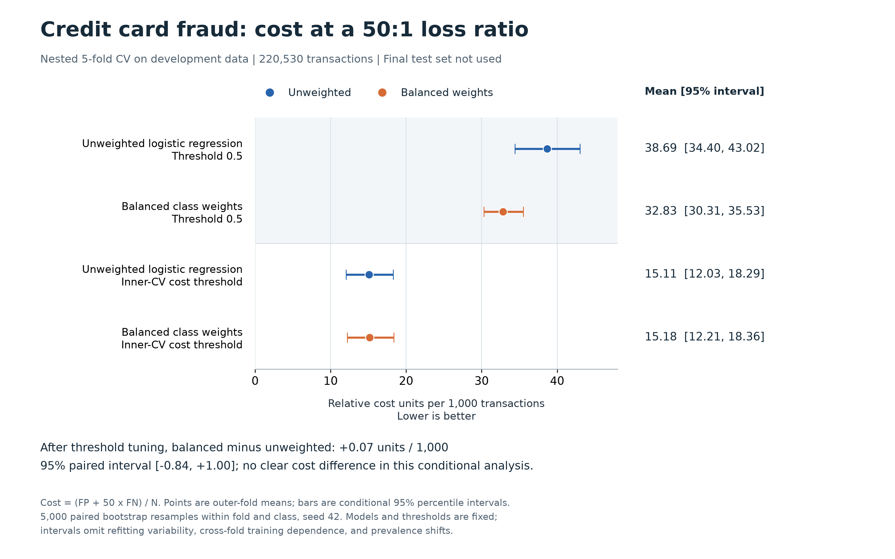

# Cost-Sensitive Credit Card Fraud Detection

**Open Team 6 — Jacob, Zhihao**

We compare unweighted logistic regression, class weighting, and threshold adjustment for rare credit-card fraud. Average Precision (AP) measures ranking quality; mean cost measures decisions at a predeclared false-negative/false-positive cost ratio of 50:1:

`mean cost = (FP + 50 * FN) / N`

The ratio is a research assumption, not an estimate of banking losses. Balanced training weights are a separate quantity, computed as `n_train / (2 * n_train_class)` within each fit.

## Data and evaluation

- OpenML 1597: 284,807 transactions, 30 original inputs, 492 frauds. Drop Time and keep 29 inputs with Class as the binary target.
- Remove 9,144 repeated input vectors, retaining the first source row. No missing or infinite values were found. Deduplication changes transaction frequencies.
- Fix a stratified 80/20 split: 220,530 development records and 55,133 sealed test records. No test data are used for model fitting, tuning, or performance scoring.
- Nested stratified five-fold CV, shuffled with seed 42. Fit StandardScaler inside every training fold. Tune L2 logistic regression over C = {0.001, 0.01, 0.1, 1, 10, 100} by inner mean AP, independently for each method.
- Select cost thresholds using the chosen C's inner out-of-fold predictions; score only on outer validation folds. Report the default 0.5 threshold separately.

## Results

All scores below are outer-fold means. AP intervals are conditional 95% bootstrap intervals.

| Model | Final development C | AP [95% interval] | Cost at 0.5 | Cost after inner threshold tuning |
|---|---:|---:|---:|---:|
| Unweighted | 1 | 0.7417 [0.6968, 0.7895] | 0.03869 | 0.01511 |
| Balanced class weights | 100 | 0.7130 [0.6646, 0.7657] | 0.03283 | 0.01518 |

Paired balanced-minus-unweighted differences:

- AP: -0.02868, interval [-0.04560, -0.01082]. Weighting reduced AP in this run.
- Tuned cost: +0.000073, interval [-0.000839, +0.001002]. The interval includes zero; neither method has a clear cost advantage under this conditional analysis.

We used 5,000 paired bootstrap resamples within each outer-fold/class stratum, seed 42, averaging metrics over folds. Models, thresholds, folds, and class counts remain fixed. Intervals omit refitting variability, cross-fold training dependence, prevalence shifts, and temporal dependence. They are not unconditional learning-algorithm intervals. Threshold changes alone do not change AP.

## Reproduce

Use Python 3.12 in a fresh local virtual environment:

```bash
python3.12 -m venv .venv
.venv/bin/python -m pip install -r requirements-lock.txt
.venv/bin/python src/data_preparation.py
.venv/bin/python src/baseline.py
.venv/bin/python src/verify_baseline.py
.venv/bin/python src/baseline_uncertainty.py
.venv/bin/python src/verify_uncertainty.py
.venv/bin/python src/class_weight.py
.venv/bin/python src/verify_class_weight.py
.venv/bin/python src/class_weight_comparison.py
.venv/bin/python src/verify_class_weight_comparison.py
```

Runs overwrite same-named generated results. Raw data are preserved and checksummed. Convergence warnings stop training; both 186-fit runs completed successfully.

## Checkpoint figure



`baseline.png` compares unweighted and balanced-class-weight logistic regression at threshold 0.5 and at thresholds selected from inner-CV predictions. Points show outer-fold mean cost per 1,000 transactions; bars show conditional 95% paired-bootstrap intervals. It is an early figure at one fixed cost ratio, not the planned cost-versus-ratio sensitivity curve.

To recreate it, open `notebooks/03_baseline_figure.ipynb`, select the project `.venv` kernel, and choose **Run All**. The notebook reads the saved comparison summary and calls `src/plot_baseline.py`; it does not train models or access test data. Alternatively:

```bash
.venv/bin/python src/plot_baseline.py
```

The PNG is saved in the project root and can accompany `baseline.txt` in the checkpoint submission.

## Project files and next steps

- `config/`: fixed experiment and uncertainty protocols.
- `src/`: training, paired uncertainty calculations, and independent verification.
- `reports/baseline/`: baseline results; `uncertainty/` contains its error bars.
- `reports/class_weight/`: control results; `comparison/` contains paired differences.
- `baseline.txt`: checkpoint submission text. Confirm that Code contains an accessible repository/notebook URL before submission.

Before the 16 November draft, Jacob will assess cost sensitivity and interpretation; Zhihao will extend fold-contained resampling, threshold comparisons, and gradient boosting. The final test set stays sealed until final evaluation.
